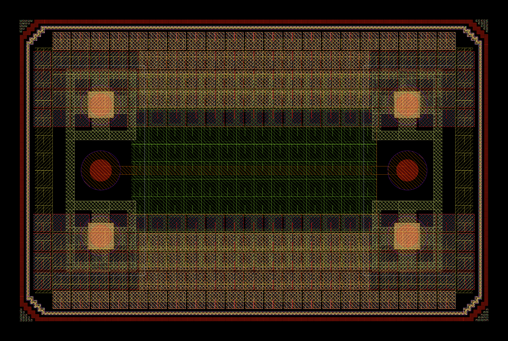

# gds_viewer

A command-line GDSII layout viewer built on [gdspy](https://github.com/heitzmann/gdspy), with IHP SG13G2 layer colors and fill patterns applied automatically. No KLayout installation is required to view a layout with correct-looking colors.

```
python gds_viewer.py layout.gds
python gds_viewer.py layout.gds --cellname MY_CELL
python gds_viewer.py layout.gds --screenshot layout.png
```

## Options

- `gds_file` (positional) - input GDSII file
- `--cellname` - cell to display (default: first top-level cell in the file)
- `--screenshot FILE.png` - render the layout to a PNG and exit, instead of opening the interactive GUI

## Interactive viewer

With no `--screenshot`, gdspy's built-in Tkinter GUI opens (pan/zoom, ruler, per-layer color/pattern/visibility toggles, ref-level depth control). Colors and fill patterns are hardcoded from `sg13g2.lyp`, so the layout looks close to its KLayout appearance without reading that file at runtime.

Purpose (datatype) layers `noqrc`, `filler`, `nofill`, and `block` are hidden by default, across every layer - toggle any of them back on from the layer list if needed.

gdspy's viewer only supports 10 built-in fill patterns, so `sg13g2.lyp`'s ~54 distinct dither patterns are mapped to the closest of those 10 by pixel density and hatch/grid orientation - a reasonable approximation, not pixel-exact.

## --screenshot export

Renders headlessly via matplotlib (no GUI/display needed, works over SSH or in CI) and saves a PNG. Unlike the interactive viewer, fill patterns here are pixel-accurate reproductions of `sg13g2.lyp`'s actual dither patterns, not an approximation - reverse-engineered by rendering the real IHP SG13G2 technology through KLayout itself and sampling the resulting pixels.

[](doc/gds_viewer_screenshot.png)

## Requirements

- `gdspy`
- `matplotlib` and `numpy` (only needed for `--screenshot`)

## How the layer styling was derived

`sg13g2.lyp` (bundled here for reference) is **not** read at runtime - `gds_viewer.py` has no dependency on it or on KLayout once written. Its `<fill-color>` values were copied straight into the `LAYER_STYLES` table.

Its `<dither-pattern>` values (e.g. `"C23"`, `"I1"`) don't have documented bitmap definitions anywhere accessible from code - KLayout resolves them internally with no public API to query. They were recovered empirically: a synthetic GDS with one swatch per distinct pattern name was rendered through a real, installed KLayout in batch mode (`klayout_app.exe -z -nc -rx -r script.rb`, using `RBA::LayoutView` to load the layout + `sg13g2.lyp` and save a PNG), then each swatch's minimal repeating tile was recovered from the rendered pixels (2D period detection, then majority-vote over all repeats to denoise anti-aliasing). The resulting bitmaps are hardcoded in `PATTERN_TILES`.

If `sg13g2.lyp` ever changes, `LAYER_STYLES` and `PATTERN_TILES` need to be regenerated using that same approach.

## License

This project is licensed under the Apache License, Version 2.0 - see [LICENSE](./LICENSE) for the full text.
