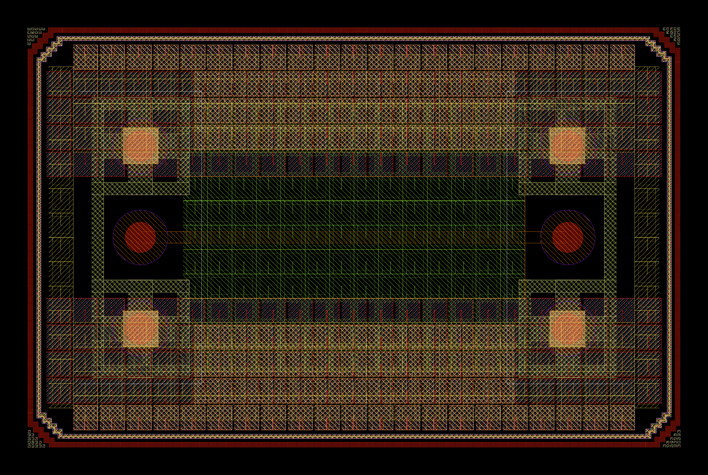

# gds_viewer

A GDSII layout viewer (a window, or a PNG without a display) built on [gdstk](https://github.com/heitzmann/gdstk) and matplotlib, with IHP SG13G2 layer colors and fill patterns applied automatically. No KLayout installation is required to view a layout with correct-looking colors.

```
pip install gds_viewer

gds_viewer layout.gds
gds_viewer layout.gds --cellname MY_CELL
gds_viewer layout.gds --screenshot layout.png --width 1200
```

Without installing, `python gds_viewer.py ...` works the same way.

From Python:

```python
import gdstk, gds_viewer

cell = gds_viewer.pick_cell(gdstk.read_gds("layout.gds"), None)   # or a cell name
gds_viewer.render_screenshot(cell, "layout.png", width_px=1200, labels=[(10.0, 0.0, "P1")])
```

`render_screenshot` still takes a gdspy cell as well; gdspy is no longer needed by gds_viewer itself (0.3 and newer). `gds_viewer.show_window(cell)` opens the interactive window from Python.

`labels` draws a marker and a text at layout coordinates, for example to show port locations. Their size follows the image size (text about 3 % of the image width), so they stay readable when the PNG is shown small. `pattern_scale` and `fill_alpha` do the same as `--pattern-scale` and `--fill-alpha`.

For other technologies than IHP SG13G2, pass `layer_colors={layer: "#rrggbb", ...}` (also `"#rrggbbaa"` with transparency): the SG13G2 styles are then not used, and each layer is a solid fill in its color, drawn in the order of the dict (first = bottom). `outline_layers` draws layers as outlines only. Without `layer_colors`, layers that have no SG13G2 style (port, region or marker layers, e.g. 800/0) are always drawn as outlines, so they don't hide the circuit. The gds2palace MCP server uses this with the material colors from a gds2palace stackup.

## Options

- `gds_file` (positional) - input GDSII file
- `--cellname` - cell to display (default: the top-level cell with the largest bounding box, never KLayout's `$$$CONTEXT_INFO$$$`: the cell that gds2palace and gds_prepare_for_EM take when no cell is named)
- `--screenshot FILE.png` - render the layout to a PNG and exit, instead of opening the interactive window
- `--width PIXELS` - width of the `--screenshot` PNG (default 2400)
- `--pattern-scale N` - draw each fill pattern pixel as an NxN block and outlines N times wider, so the patterns stay visible when the PNG is shown smaller than its size (default 1: exact KLayout look)
- `--fill-alpha 0..1` - add a solid fill with this opacity under the fill patterns, so metal areas stay visible when the PNG is shown small (default: exact KLayout look)
- `--version` - print the version

## Interactive viewer

With no `--screenshot`, a matplotlib window opens. It draws the layout the same way as `--screenshot`, with the exact `sg13g2.lyp` fill patterns, redrawn at screen resolution after each zoom, so they look as in KLayout at every zoom level.

- Pan and zoom with the toolbar (or keys `p` and `o`), the scroll wheel zooms around the cursor, `h` (home) shows the whole layout again. The cursor position (in um) is shown at the bottom.
- The layer list on the right (names from `sg13g2.lyp`, layer/datatype numbers) switches layers on and off. Purpose (datatype) layers `noqrc`, `filler`, `nofill` and `block` start switched off, across every layer.
- GDS texts are shown with their layer.

Since 0.3 the window no longer uses gdspy's Tkinter viewer, which had only 10 approximate fill patterns, a ruler and per-layer color editing. The window is always flattened to all hierarchy levels.

## --screenshot export

Renders headlessly via matplotlib (no GUI/display needed, works over SSH or in CI) and saves a PNG. Fill patterns (here and in the window) are pixel-accurate reproductions of `sg13g2.lyp`'s actual dither patterns, not an approximation - reverse-engineered by rendering the real IHP SG13G2 technology through KLayout itself and sampling the resulting pixels.

[](https://raw.githubusercontent.com/VolkerMuehlhaus/gds_viewer/main/doc/gds_viewer_screenshot.png)

## Requirements

- `gdstk`, `matplotlib` and `numpy` (`pip install gds_viewer` installs them)
- for the window: one of matplotlib's interactive backends, e.g. Tk (`tkinter`, part of most Python installations) or Qt (PySide6/PyQt)

## How the layer styling was derived

`sg13g2.lyp` (bundled here for reference) is **not** read at runtime - `gds_viewer.py` has no dependency on it or on KLayout once written. Its `<fill-color>` values were copied straight into the `LAYER_STYLES` table.

Its `<dither-pattern>` values (e.g. `"C23"`, `"I1"`) don't have documented bitmap definitions anywhere accessible from code - KLayout resolves them internally with no public API to query. They were recovered empirically: a synthetic GDS with one swatch per distinct pattern name was rendered through a real, installed KLayout in batch mode (`klayout_app.exe -z -nc -rx -r script.rb`, using `RBA::LayoutView` to load the layout + `sg13g2.lyp` and save a PNG), then each swatch's minimal repeating tile was recovered from the rendered pixels (2D period detection, then majority-vote over all repeats to denoise anti-aliasing). The resulting bitmaps are hardcoded in `PATTERN_TILES`.

If `sg13g2.lyp` ever changes, `LAYER_STYLES` and `PATTERN_TILES` need to be regenerated using that same approach.

## License

This project is licensed under the Apache License, Version 2.0 - see [LICENSE](https://github.com/VolkerMuehlhaus/gds_viewer/blob/main/LICENSE) for the full text.
